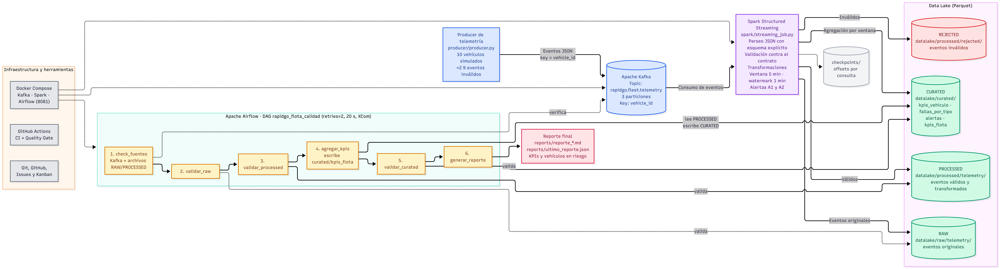

# RapidGo · Telemetría y mantenimiento de flota

**Equipo 6 · Variante 8 (Mantenimiento de flota)**

Pipeline de datos en tiempo real que simula la telemetría de una flota de vehículos de reparto. Detecta mantenimientos vencidos y temperaturas críticas del motor, y genera un reporte de calidad y KPIs.

- **Release final:** [v1.0.0](https://github.com/SorathDem/RapidGo/releases/tag/v1.0.0)
- **Video de la demostración:** se publica junto con el release v1.0.0.
- **Releases anteriores:** [v0.2.0-streaming](https://github.com/SorathDem/RapidGo/releases/tag/v0.2.0-streaming) · [v0.3.0-orchestration](https://github.com/SorathDem/RapidGo/releases/tag/v0.3.0-orchestration)

## Arquitectura



1. **Producer** (`producer/`): genera eventos JSON de 10 vehículos simulados (alrededor de un 2 % inválidos a propósito) y los publica en Kafka con key `vehicle_id` y el header `equipo`.
2. **Kafka**: topic `rapidgo.fleet.telemetry` con **3 particiones**. Al usar la key `vehicle_id`, todos los eventos de un vehículo caen en la misma partición y conservan su orden ([ADR-001](docs/decisions/ADR-001-particionado-por-vehicle-id.md)).
3. **Spark Structured Streaming** (`spark/`): parsea el JSON con esquema explícito, valida contra el contrato, aplica las transformaciones y agrega por **ventana de 5 minutos con watermark de 1 minuto**. Usa checkpoints en `checkpoints/`.
4. **Data Lake (Parquet)**, con estas carpetas:
   - `datalake/raw/telemetry/`: eventos originales.
   - `datalake/processed/telemetry/`: eventos válidos y transformados.
   - `datalake/processed/rejected/`: eventos que no cumplen el contrato.
   - `datalake/curated/`: `kpis_vehiculo`, `fallas_por_tipo`, `alertas` y `kpis_flota`.
5. **Airflow**: DAG `rapidgo_flota_calidad` con 6 tasks, `check_fuentes → validar_raw → validar_processed → agregar_kpis → validar_curated → generar_reporte`. Usa `retries=2` con 20 s de espera y pasa los datos por XCom ([ADR-003](docs/decisions/ADR-003-orquestacion-recuperacion.md)).
6. **Reporte**: `reports/reporte_AAAAMMDD_HHMMSS.md` y `reports/ultimo_reporte.json`.

Más detalle en [docs/arquitectura.md](docs/arquitectura.md).

## Evento, KPIs y alertas

El contrato del evento está en [docs/contrato-evento.md](docs/contrato-evento.md) y el schema en [docs/evento.schema.json](docs/evento.schema.json). Hay ejemplos en `samples/`.

**KPIs** (`spark/aggregations.py`, por vehículo y ventana):
- `km_recorridos`: odómetro máximo menos odómetro mínimo dentro de la ventana.
- Fallas por tipo (`fault_code`).
- Vehículos en riesgo: los que tienen A1 o A2 activa (`airflow/dags/rg_kpis.py`).

**Alertas** (umbrales en `spark/config.py`, justificados en [docs/kpis-alertas.md](docs/kpis-alertas.md)):

| Alerta | Regla |
|---|---|
| A1 · Mantenimiento vencido | `km_since_last_service > 5000` |
| A2 · Temperatura crítica | 2 o más lecturas con `engine_temp_c > 105` dentro de la ventana |

A2 cuenta lecturas dentro de la ventana y no lecturas consecutivas. Detectar lecturas consecutivas exige mantener estado por vehículo en streaming. La decisión y la calibración del umbral están en [ADR-002](docs/decisions/ADR-002-calibracion-alerta-a2.md).

## Estructura del repositorio

```
producer/          generator.py (eventos simulados) y producer.py (envío a Kafka)
spark/             config, schema, transformations, rules, aggregations, sinks y streaming_job
airflow/dags/      rapidgo_flota_dag.py y módulos rg_config, rg_fuentes, rg_calidad, rg_kpis, rg_reporte
tests/             pruebas de contrato, reglas, generador y Airflow
samples/           eventos de ejemplo (válidos e inválidos)
docs/              arquitectura, contrato, KPIs, decisiones (ADR) y checkpoints semanales
.github/workflows/ CI con Quality Gate
docker-compose.yml Zookeeper, Kafka, Spark y Airflow
```

## Prerrequisitos

Las instrucciones están probadas en **Windows con PowerShell**.

- **Docker Desktop** en ejecución.
- **Python 3.12**.
- **Java 17** para Spark. Spark 3.5.3 no funciona con Java 23 o superior: falla con `java.lang.UnsupportedOperationException: getSubject is not supported`.
- **Hadoop para Windows:** `winutils.exe` y `hadoop.dll` en `C:\hadoop\bin`. Sin ellos Spark no puede escribir el Parquet ni los checkpoints (`HADOOP_HOME and hadoop.home.dir are unset`).

## Cómo ejecutarlo

**1. Clonar e instalar dependencias**
```powershell
git clone https://github.com/SorathDem/RapidGo.git
cd RapidGo
python -m venv .venv
.\.venv\Scripts\Activate.ps1
pip install -r requirements.txt
```

**2. Levantar Zookeeper, Kafka, Spark y Airflow**
```powershell
docker compose up -d
docker compose ps
```
Espera a que los contenedores estén en `running`. La primera vez Airflow tarda 1 o 2 minutos, porque instala pandas y pyarrow.

**3. Crear el topic** (solo la primera vez; el broker no crea topics automáticamente)
```powershell
docker exec rapidgo-kafka kafka-topics --bootstrap-server localhost:9092 --create --if-not-exists --topic rapidgo.fleet.telemetry --partitions 3 --replication-factor 1
docker exec rapidgo-kafka kafka-topics --bootstrap-server localhost:9092 --describe --topic rapidgo.fleet.telemetry
```

**4. Configurar Java 17 y Hadoop en la terminal de Spark** (ajusta la ruta del JDK a la tuya)
```powershell
$env:JAVA_HOME = "C:\Program Files\Eclipse Adoptium\jdk-17.x.x-hotspot"
$env:HADOOP_HOME = "C:\hadoop"
$env:PYSPARK_PYTHON = "$PWD\.venv\Scripts\python.exe"
$env:PYSPARK_DRIVER_PYTHON = $env:PYSPARK_PYTHON
$env:PATH = "$env:JAVA_HOME\bin;$env:HADOOP_HOME\bin;$env:PATH"
java -version
```
`java -version` debe mostrar la versión 17. Estas variables solo duran mientras la terminal esté abierta.

**5. Arrancar Spark** (terminal 1, déjala corriendo)
```powershell
python -m spark.streaming_job
```

**6. Enviar eventos** (terminal 2, con el entorno virtual activado)
```powershell
.\.venv\Scripts\Activate.ps1
python -m producer.producer --max-eventos 1500 --rate 20
```
Cada envío imprime `key=VEH-... -> particion=N offset=N`. Otras opciones: `--vehiculos` (10 por defecto), `--invalidos` (0.02 por defecto) y `--bootstrap` (`localhost:9092` por defecto).

Espera 2 o 3 minutos para que Spark escriba las ventanas. Comprueba que existan `datalake\raw\telemetry` y `datalake\processed\telemetry`, y luego detén Spark con `Ctrl + C`.

**7. Ejecutar el DAG en Airflow**
```powershell
docker exec airflow cat /opt/airflow/standalone_admin_password.txt
```
Abre `http://localhost:8081`, entra con el usuario `admin` y la contraseña anterior, y lanza el DAG `rapidgo_flota_calidad` con **Trigger DAG**. Las 6 tasks deben terminar en verde.

**8. Ver el reporte**
```powershell
Get-Content reports\reporte_*.md
```

**Repetir desde cero (opcional).** Detén Spark y borra los datos generados:
```powershell
Remove-Item -Recurse -Force datalake, checkpoints, reports
```

## Pruebas y GitHub Actions

```powershell
python -m pytest -v
```
Hay 17 pruebas: contrato, reglas A1/A2, generador y Airflow (estructura y flujo del DAG, calidad, KPIs y reporte). En Windows, las pruebas que necesitan Airflow instalado se omiten; en CI se ejecutan todas.

El workflow [`.github/workflows/ci.yml`](.github/workflows/ci.yml) (`CI RapidGo`) se ejecuta en `push` y `pull_request` hacia `main` y `dev`, y a mano con `workflow_dispatch`. El job `validar` hace lo siguiente:
1. Instala Python 3.12, Airflow 2.10.5 (con sus constraints) y `requirements.txt`.
2. Revisa la sintaxis con `python -m compileall`.
3. Comprueba que el DAG se importe sin errores con `DagBag`.
4. Ejecuta `pytest -v`.
5. Valida `docker compose config`.
6. **Quality Gate:** falla si falta el README, el diagrama, algún checkpoint o algún ADR (001 a 003), o si queda texto pendiente marcado con COMPLETAR.
7. Empaqueta el proyecto como artefacto descargable `rapidgo-flota.zip`.

## Resultados y evidencias

**Spark Structured Streaming** (Semana 2; ventana de prueba de 1 minuto y watermark de 30 s):

| Métrica | Valor |
|---|---|
| Eventos enviados | 1500 |
| Procesados | 1468 |
| Rechazados | 32 |
| Filas vehículo-ventana en `curated/kpis_vehiculo` | 21 |
| Reinicio con checkpoint | no reprocesó (siguió en 1468) |
| Particionado | `VEH-008` cayó siempre en la partición 2 (4 de 4 eventos) |

**DAG de Airflow** (corrida del 11/11/2026, run `manual__2026-11-12T04:33:37.355833+00:00`):

| Métrica | Valor |
|---|---|
| Filas RAW / PROCESSED / CURATED | 44545 / 43659 / 10 |
| Vehículos monitoreados | 10 |
| Vehículos en riesgo | 10 (100.0 %) |
| Alertas A1 / A2 | 10 / 10 |
| Fallas por tipo | P0128 = 597 · P0217 = 548 · P0300 = 549 · P0420 = 588 |
| Duración del DAG | 75,6 s |

**Fallo controlado:** con Kafka detenido, `check_fuentes` falló tras 2 reintentos con `ConnectionError: Kafka no disponible en kafka:9092`. Con la carpeta RAW renombrada, `validar_raw` falló con `CalidadError: RAW vacio`. En los dos casos se recuperó y el DAG terminó en verde. El detalle está en el [checkpoint de la Semana 3](docs/checkpoints/semana3.md) y en el [ADR-003](docs/decisions/ADR-003-orquestacion-recuperacion.md).

## Limitaciones y trabajo futuro

- **A2 sin recalibrar.** El umbral de 2 lecturas críticas marca en riesgo a casi toda la flota: el 81 % de las filas vehículo-ventana en la Semana 2 y el 100 % de los vehículos en el DAG. El [ADR-002](docs/decisions/ADR-002-calibracion-alerta-a2.md) propone pasar a una proporción (≥ 15 % de las lecturas de la ventana), pero `spark/config.py` sigue en 2.
- **`agregar_kpis` usa todo el histórico.** En Airflow, el riesgo se calcula sobre todas las lecturas de cada vehículo y no por ventana, lo que infla A1 y A2.
- **Dependencia del entorno Windows.** Spark corre en local y necesita Java 17 y `winutils.exe`.
- **Sin alta disponibilidad.** Hay un solo broker de Kafka con factor de replicación 1.
- **Datos simulados.** Los umbrales se calibraron con datos sintéticos de 10 vehículos y pocas corridas.
- **Paralelismo limitado.** Con 3 particiones el consumo queda topado en 3 consumidores; aumentarlas cambia la partición de cada `vehicle_id`.

## Equipo y contribuciones

| Integrante | Responsabilidades | Issues | PR principales |
|---|---|---|---|
| Santiago Acosta ([@SorathDem](https://github.com/SorathDem)) | Repo, colaboradores y Kanban; producer con key `vehicle_id`; DAG base de Airflow; estabilización con clon limpio | [#1](https://github.com/SorathDem/RapidGo/issues/1), [#2](https://github.com/SorathDem/RapidGo/issues/2), [#3](https://github.com/SorathDem/RapidGo/issues/3), [#11](https://github.com/SorathDem/RapidGo/issues/11), [#15](https://github.com/SorathDem/RapidGo/issues/15), [#19](https://github.com/SorathDem/RapidGo/issues/19) | [#28](https://github.com/SorathDem/RapidGo/pull/28), [#42](https://github.com/SorathDem/RapidGo/pull/42), [#49](https://github.com/SorathDem/RapidGo/pull/49) |
| Valentina Galindo ([@valentinagalindo045-cmd](https://github.com/valentinagalindo045-cmd)) | Diagrama de arquitectura y ADR-001; Spark Streaming; Airflow en Docker y KPIs; Quality Gate y CI final | [#4](https://github.com/SorathDem/RapidGo/issues/4), [#5](https://github.com/SorathDem/RapidGo/issues/5), [#12](https://github.com/SorathDem/RapidGo/issues/12), [#41](https://github.com/SorathDem/RapidGo/issues/41), [#18](https://github.com/SorathDem/RapidGo/issues/18), [#19](https://github.com/SorathDem/RapidGo/issues/19) | [#25](https://github.com/SorathDem/RapidGo/pull/25), [#29](https://github.com/SorathDem/RapidGo/pull/29), [#43](https://github.com/SorathDem/RapidGo/pull/43), [#51](https://github.com/SorathDem/RapidGo/pull/51), [#53](https://github.com/SorathDem/RapidGo/pull/53) |
| Alejandro Arevalo ([@DAlejo04](https://github.com/DAlejo04)) | Contrato del evento; KPIs y alertas; ventanas, alertas y ADR-002; calidad, fallo controlado y ADR-003; README final | [#6](https://github.com/SorathDem/RapidGo/issues/6), [#7](https://github.com/SorathDem/RapidGo/issues/7), [#13](https://github.com/SorathDem/RapidGo/issues/13), [#16](https://github.com/SorathDem/RapidGo/issues/16), [#52](https://github.com/SorathDem/RapidGo/issues/52), [#19](https://github.com/SorathDem/RapidGo/issues/19) | [#20](https://github.com/SorathDem/RapidGo/pull/20), [#22](https://github.com/SorathDem/RapidGo/pull/22), [#40](https://github.com/SorathDem/RapidGo/pull/40), [#45](https://github.com/SorathDem/RapidGo/pull/45) |
| Alejandro Ubaque ([@alejandroubaque](https://github.com/alejandroubaque)) | Estructura del repo, Docker y requirements; checkpoint Semana 1; CI y pruebas; CI ampliado y reporte final; video y release | [#8](https://github.com/SorathDem/RapidGo/issues/8), [#9](https://github.com/SorathDem/RapidGo/issues/9), [#10](https://github.com/SorathDem/RapidGo/issues/10), [#14](https://github.com/SorathDem/RapidGo/issues/14), [#17](https://github.com/SorathDem/RapidGo/issues/17), [#19](https://github.com/SorathDem/RapidGo/issues/19) | [#21](https://github.com/SorathDem/RapidGo/pull/21), [#23](https://github.com/SorathDem/RapidGo/pull/23), [#26](https://github.com/SorathDem/RapidGo/pull/26), [#36](https://github.com/SorathDem/RapidGo/pull/36), [#44](https://github.com/SorathDem/RapidGo/pull/44) |

## Documentación

- Checkpoints: [Semana 1](docs/checkpoints/semana1.md) · [Semana 2](docs/checkpoints/semana2.md) · [Semana 3](docs/checkpoints/semana3.md)
- Decisiones: [ADR-001](docs/decisions/ADR-001-particionado-por-vehicle-id.md) · [ADR-002](docs/decisions/ADR-002-calibracion-alerta-a2.md) · [ADR-003](docs/decisions/ADR-003-orquestacion-recuperacion.md) · [todas](docs/decisions/)
- Contrato: [docs/contrato-evento.md](docs/contrato-evento.md) · [docs/evento.schema.json](docs/evento.schema.json)
- KPIs y umbrales: [docs/kpis-alertas.md](docs/kpis-alertas.md)
- Evidencias de Kafka (Semana 1): [docs/evidencias/](docs/evidencias/)
