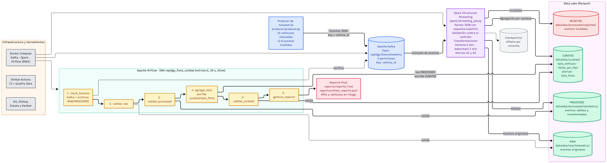
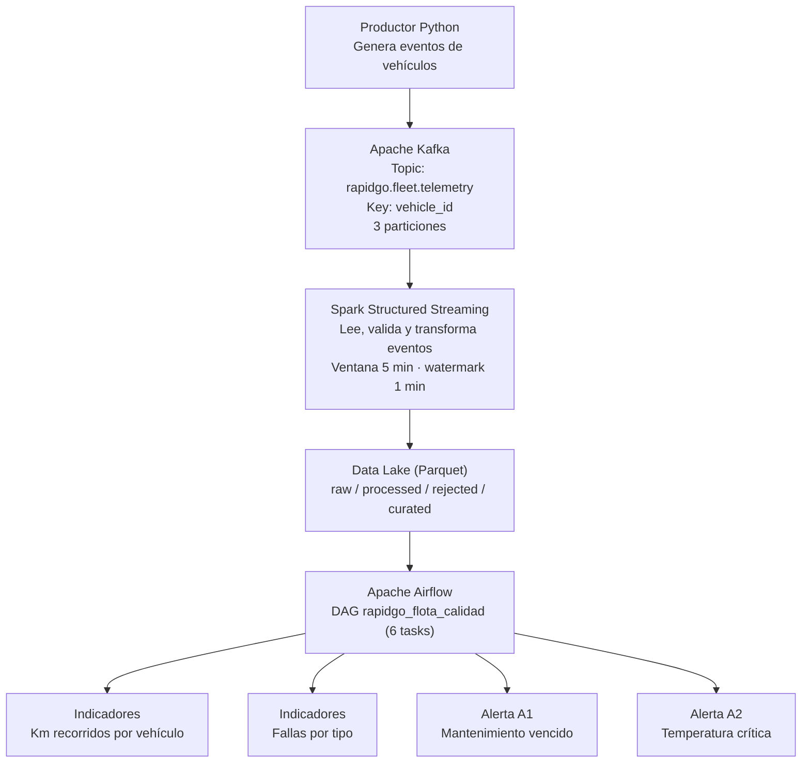

# Arquitectura de RapidGo — Variante 8

## 1. Objetivo

El sistema procesa eventos relacionados con el mantenimiento de los vehículos de RapidGo para identificar posibles fallas mecánicas, acumular kilometraje y generar alertas que ayuden a prevenir problemas durante las entregas.

## 2. Diagrama de arquitectura

Versión simplificada:

## 3. Componentes

- **Productor Python:** genera eventos de telemetría y mantenimiento de los vehículos, con datos como identificador, kilometraje, temperatura del motor y código de falla.
- **Apache Kafka:** recibe y distribuye los eventos mediante el topic `rapidgo.fleet.telemetry`, con 3 particiones y key `vehicle_id`.
- **Spark Structured Streaming:** consume los eventos, valida sus campos contra el contrato, transforma los datos y agrega por ventana de 5 minutos con watermark de 1 minuto para detectar condiciones de riesgo.
- **Data Lake:** almacena los datos en Parquet: `raw/telemetry` (originales), `processed/telemetry` (válidos y transformados), `processed/rejected` (inválidos) y `curated` (`kpis_vehiculo`, `fallas_por_tipo`, `alertas` y `kpis_flota`). El streaming usa checkpoints en `checkpoints/` para no reprocesar al reiniciar.
- **Apache Airflow:** el DAG `rapidgo_flota_calidad` ejecuta 6 tasks (`check_fuentes → validar_raw → validar_processed → agregar_kpis → validar_curated → generar_reporte`) con 2 reintentos de 20 s y genera el reporte en `reports/`.
- **Indicadores y alertas:** presentan el kilometraje acumulado, las fallas por tipo y los vehículos que necesitan revisión.

## 4. Flujo de datos

1. El productor Python genera un evento para un vehículo.
2. Kafka recibe el evento en `rapidgo.fleet.telemetry`.
3. Spark Structured Streaming consume el evento y valida sus datos.
4. Spark transforma los eventos y calcula información útil para el seguimiento de la flota.
5. Los datos se almacenan en el Data Lake: `raw` para datos de entrada, `processed` para datos validados y transformados, `processed/rejected` para los eventos inválidos y `curated` para información preparada para indicadores y reportes.
6. Airflow verifica las fuentes, valida cada capa, calcula los KPIs de la flota y genera el reporte final.
7. El sistema prepara indicadores y detecta situaciones que requieren atención.

## 5. KPIs y alertas iniciales

### KPIs

- Kilómetros recorridos por vehículo y ventana (`km_recorridos`: odómetro máximo menos mínimo).
- Cantidad de fallas por tipo.
- Cantidad de vehículos en riesgo.

### Alertas

- **A1 · Mantenimiento vencido:** cuando `km_since_last_service` supera los 5.000 km. En la Semana 1 se propuso 10.000 km como valor inicial; se ajustó a 5.000 km con las fuentes de [kpis-alertas.md](kpis-alertas.md).
- **A2 · Temperatura crítica:** cuando hay 2 o más lecturas con `engine_temp_c > 105` dentro de la misma ventana. La decisión de contar dentro de la ventana, en lugar de exigir lecturas consecutivas, está en [ADR-002](decisions/ADR-002-calibracion-alerta-a2.md).

Los umbrales se calibraron con datos simulados; el ADR-002 documenta la recalibración pendiente de A2.

## 6. Tecnologías

- Python para la generación de eventos.
- Apache Kafka para la mensajería.
- Apache Spark Structured Streaming para el procesamiento de eventos.
- Parquet para el almacenamiento analítico.
- Apache Airflow para la orquestación.
- Docker Compose para el entorno local.
- Git y GitHub para el control de versiones y la revisión del trabajo.

## 7. Estado de implementación

- **Semana 1:** una prueba inicial de Kafka, sobre un topic de prueba (`rapidgo.fleet.mantenimiento.v1`, 4 particiones), confirmó el envío y la recepción de tres eventos. Los dos eventos con la clave `VAN-017` llegaron a la misma partición y `VAN-018` llegó a otra. Ver [evidencias](evidencias/).
- **Semana 2:** se implementaron el producer sobre `rapidgo.fleet.telemetry` (3 particiones), Spark Structured Streaming con las capas `raw`, `processed`, `rejected` y `curated` en Parquet, y las alertas A1 y A2. Ver [checkpoint Semana 2](checkpoints/semana2.md).
- **Semana 3:** se agregó la orquestación con Airflow, con validaciones de calidad, KPIs de flota y reporte final. Ver [checkpoint Semana 3](checkpoints/semana3.md).
