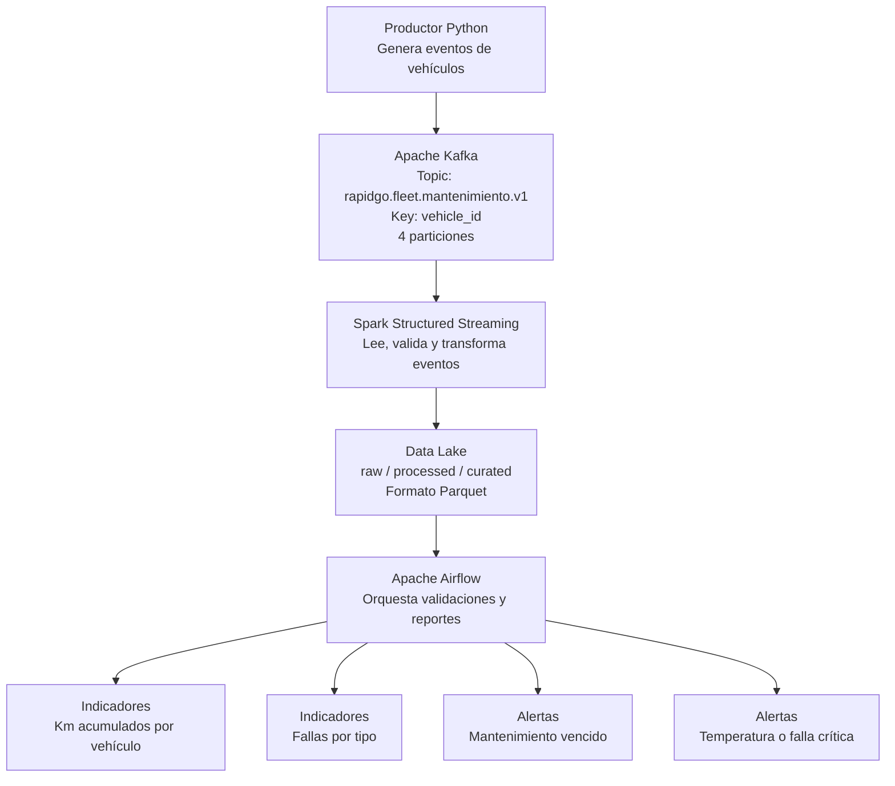

# Arquitectura de RapidGo — Variante 8

## 1. Objetivo

El sistema procesa eventos relacionados con el mantenimiento de los vehículos de RapidGo para identificar posibles fallas mecánicas, acumular kilometraje y generar alertas que ayuden a prevenir problemas durante las entregas.

## 2. Diagrama de arquitectura

## 3. Componentes

- **Productor Python:** genera eventos de telemetría y mantenimiento de los vehículos, con datos como identificador, kilometraje, temperatura del motor y código de falla.
- **Apache Kafka:** recibe y distribuye los eventos mediante el topic `rapidgo.fleet.mantenimiento.v1`.
- **Spark Structured Streaming:** consume los eventos, valida sus campos, transforma los datos y detecta condiciones que puedan representar riesgos.
- **Data Lake:** almacena los datos en las capas `raw`, `processed` y `curated`. Se utiliza Parquet para los datos procesados y se contempla el uso de checkpoints para la recuperación del streaming.
- **Apache Airflow:** coordina tareas de validación, agregación y generación de reportes a partir de los datos almacenados.
- **Indicadores y alertas:** presentan el kilometraje acumulado, las fallas por tipo y los vehículos que necesitan revisión.

## 4. Flujo de datos

1. El productor Python genera un evento para un vehículo.
2. Kafka recibe el evento en `rapidgo.fleet.mantenimiento.v1`.
3. Spark Structured Streaming consume el evento y valida sus datos.
4. Spark transforma los eventos y calcula información útil para el seguimiento de la flota.
5. Los datos se almacenan en el Data Lake: `raw` para datos de entrada, `processed` para datos validados y transformados, y `curated` para información preparada para indicadores y reportes.
6. Airflow coordina las validaciones y agregaciones que correspondan.
7. El sistema prepara indicadores y detecta situaciones que requieren atención.

## 5. KPIs y alertas iniciales

### KPIs

- Kilómetros acumulados por vehículo.
- Cantidad de fallas por tipo.
- Cantidad de vehículos en riesgo.

### Alertas

- **Mantenimiento vencido:** cuando los kilómetros recorridos desde el último mantenimiento superen el umbral definido. Como valor inicial de prueba se propone 10.000 km.
- **Parámetro mecánico crítico:** cuando la temperatura del motor supere los 105 °C o se registre un código de falla clasificado como crítico.

Los umbrales son valores iniciales para la demostración y deberán validarse con criterios técnicos adecuados.

## 6. Tecnologías

- Python para la generación de eventos.
- Apache Kafka para la mensajería.
- Apache Spark Structured Streaming para el procesamiento de eventos.
- Parquet para el almacenamiento analítico.
- Apache Airflow para la orquestación.
- Docker Compose para el entorno local.
- Git y GitHub para el control de versiones y la revisión del trabajo.

## 7. Estado de implementación

La prueba inicial de Kafka confirmó el envío y la recepción de tres eventos. Se observó que los dos eventos con la clave `VAN-017` llegaron a la misma partición y que `VAN-018` llegó a otra.

La integración con Spark, el almacenamiento Parquet y la orquestación con Airflow se desarrollará en las siguientes etapas del proyecto.
